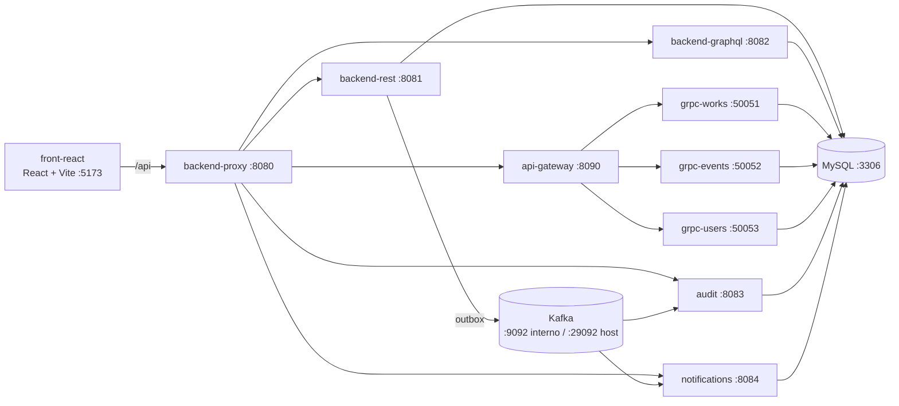

# Museo Virtual - Trabajo Práctico de Sistemas Distribuidos

Trabajo práctico grupal para la materia **Desarrollo de Software en Sistemas Distribuidos**. El sistema implementa un museo virtual con tres backends (REST, GraphQL y gRPC), un proxy que unifica el acceso, mensajería asíncrona con Kafka y un frontend en React.

## Integrantes

* Luciano Rodriguez
* Ariel Mendoza
* Luca Lazarte
* Julián Valiño

## Alcance funcional

* Catálogo de obras con filtros por época, técnica, ubicación, disponibilidad y texto libre.
* Comentarios sobre obras, con moderación del autor o de un administrador.
* Gestión de eventos (alta, edición y baja lógica) e inscripciones con control de cupo.
* Recorrido personalizado por salas según preferencias, duración y cantidad de obras.
* Recomendaciones de obras y comparación entre obras.
* Exploración por era: obras, artistas y eventos relacionados.
* Reporte de asistencia en pantalla (GraphQL) y exportación a Excel (REST).
* Notificaciones in-app de novedades de eventos y auditoría de cada cambio.

### Roles y permisos

| Acción | Público | VISITANTE | CURADOR | ADMINISTRADOR |
| --- | :---: | :---: | :---: | :---: |
| Ver catálogo, obras, eventos y comentarios | ✅ | ✅ | ✅ | ✅ |
| Registrarse / iniciar sesión | ✅ | — | — | — |
| Comentar una obra | — | ✅ | ✅ | ✅ |
| Inscribirse a un evento | — | ✅ | ✅ | ✅ |
| Preferencias y filtros guardados | — | ✅ | ✅ | ✅ |
| Recorrido personalizado y recomendaciones | — | ✅ | — | — |
| Comparar obras y explorar por era | — | ✅ | ✅ | ✅ |
| Crear, editar y eliminar obras y eventos | — | — | ✅ | ✅ |
| Reporte de asistencia y auditoría | — | — | ✅ | ✅ |
| Eliminar cualquier comentario | — | — | — | ✅ |

> Las restricciones se aplican en el backend. El frontend solo oculta las pantallas que el rol no puede usar.

## Arquitectura

El frontend (React + Vite) corre en el host y consume todo a través de `/api`, que Vite proxya a `http://localhost:8080` (el `backend-proxy`). El proxy deriva cada request a REST, GraphQL, al API Gateway de gRPC, a notificaciones o a auditoría según el prefijo.



### Servicios

| Servicio | Tecnología | Perfil de Compose | Puerto host | Puerto interno | Descripción |
| --- | --- | --- | --- | --- | --- |
| `front-react` | React + Vite | — (fuera de Docker) | 5173 | — | Interfaz de usuario |
| `backend-proxy` | Go | `proxy`, `full` | 8080 | 8080 | Punto de entrada único para el frontend |
| `backend-rest` | Java (Spring Boot) | `rest`, `full` | 8081 | 8081 | API REST |
| `backend-graphql` | Go | `graphql`, `full` | 8082 | 8082 | API GraphQL |
| `audit` | Go | `rest`, `full` | 8083 | 8083 | Consumidor de eventos y API de auditoría |
| `notifications` | Node.js | `rest`, `full` | 8084 | 8084 | Consumidor de eventos y API de notificaciones |
| `api-gateway` | Node.js | `grpc`, `full` | 8090 | 8090 | Gateway HTTP sobre los servicios gRPC |
| `grpc-works` | Python | `grpc`, `full` | 50051 | 50051 | Servicio gRPC de obras |
| `grpc-events` | Python | `grpc`, `full` | 50052 | 50052 | Servicio gRPC de eventos |
| `grpc-users` | Python | `grpc`, `full` | 50053 | 50053 | Servicio gRPC de usuarios |
| `mysql` | MySQL 8 | — (siempre) | 3306 | 3306 | Base de datos (`museo_virtual`) |
| `kafka` | Apache Kafka 4.3.1 (KRaft) | — (siempre) | 29092 | 9092 | Broker de mensajería asíncrona |
| `kafka-init` | Apache Kafka 4.3.1 | — (siempre) | — | — | Crea los topics y termina |
| `kafka-ui` | Kafbat UI | `rest`, `full` | 8085 | 8080 | Consola web para topics y mensajes |

`mysql`, `kafka` y `kafka-init` no tienen perfil: se levantan con cualquier `docker compose up`. El resto solo arranca si su perfil está activo.

## Requisitos previos

* **Docker Desktop** con Docker Compose v2 (en Windows, con el backend WSL2 habilitado).
* **Node.js >= 20.19** y **npm** (probado con Node 24).
* **Git**.
* Espacio en disco: la primera construcción baja imágenes y dependencias; reservá al menos 8 GB libres y 4 GB de RAM para Docker.

No necesitás Java, Maven, Go ni Python instalados para levantar el proyecto: todo el backend se construye dentro de Docker. Solo hacen falta si querés correr los tests localmente (ver [Pruebas](#pruebas)).

## Setup rápido

```bash
git clone https://github.com/lapizgoma/tp-distrib.git
cd tp-distrib
cp .env-example .env
docker compose --profile full up --build -d
cd front-react && npm install && npm run dev
```

En PowerShell:

```powershell
git clone https://github.com/lapizgoma/tp-distrib.git
cd tp-distrib
Copy-Item .env-example .env
docker compose --profile full up --build -d
cd front-react
npm install
npm run dev
```

Luego abrí <http://localhost:5173>.

## Setup detallado

### 1. Clonar el repositorio

```bash
git clone https://github.com/lapizgoma/tp-distrib.git
cd tp-distrib
```

Si el repositorio es privado, usá SSH: `git clone git@github.com:lapizgoma/tp-distrib.git`.

### 2. Configurar las variables de entorno

```bash
cp .env-example .env
```

En Windows (PowerShell):

```powershell
Copy-Item .env-example .env
```

El compose trae valores por defecto, así que este paso no es obligatorio para desarrollo, pero permite ajustar puertos, credenciales y secretos.

| Variable | Default | Descripción |
| --- | --- | --- |
| `DB_HOST` | `mysql` | Host de MySQL dentro de la red de Docker. No cambiar si usás Compose |
| `DB_HOST_PORT` | `3306` | Puerto publicado en el host. Cambialo si ya tenés un MySQL local usando 3306 |
| `DB_PORT` | `3306` | Puerto interno de MySQL. Dejalo en 3306 salvo que sepas lo que hacés |
| `DB_NAME` | `museo_virtual` | Nombre de la base |
| `DB_USER` / `DB_PASSWORD` | `root` / `root` | Credenciales de MySQL |
| `JWT_SECRET` | `dev-only-secret-key-change-me-please-0123456789` | Secreto compartido por REST, GraphQL, gateway, auditoría y notificaciones. Debe tener al menos 32 caracteres |
| `JWT_ISSUER` | `museo-virtual` | Emisor del token. Debe coincidir entre los servicios que lo validan |
| `JWT_EXPIRATION` | `3600` | Vida del token en segundos |
| `KAFKA_PORT` | `29092` | Puerto del broker publicado en el host (el interno es 9092) |
| `KAFKA_UI_PORT` | `8085` | Puerto de Kafka UI |
| `GRPC_WORKS_PORT` | `50051` | Puerto host de `grpc-works` |
| `GRPC_EVENTS_PORT` | `50052` | Puerto host de `grpc-events` |
| `GRPC_USERS_PORT` | `50053` | Puerto host de `grpc-users` |
| `GRPC_MAX_WORKERS` | `10` | Workers de cada servicio gRPC |
| `DB_POOL_SIZE` | `5` | Conexiones por servicio gRPC |
| `ROOM_TRANSITION_MINUTES` | `5` | Minutos de traslado entre salas en el planificador de recorridos |

> **Ojo con los puertos.** Si cambiás `DB_PORT` también cambia el puerto al que se conectan los backends, y MySQL seguiría escuchando en 3306. Para evitar conflictos con un MySQL local usá `DB_HOST_PORT`.

Cada servicio trae además su propia plantilla (`.env-example` o `.env.example`) en `backend-rest/`, `backend-graphql/`, `audit/`, `notifications/`, `api-gateway/` y `grpc-*/`, para ejecutarlo fuera de Docker. No son necesarias si usás el compose.

### 3. Levantar el backend con Docker

Con Docker Desktop abierto, desde la raíz del proyecto:

```bash
docker compose --profile full up --build
```

* `--profile full` levanta todos los servicios.
* `--build` fuerza la reconstrucción de las imágenes. La primera vez tarda varios minutos (Maven, Go y Python); en arranques posteriores podés omitirlo.
* Agregá `-d` para dejar los contenedores en segundo plano.

#### Perfiles disponibles

| Perfil | Qué levanta | Cuándo usarlo |
| --- | --- | --- |
| *(sin perfil)* | `mysql`, `kafka`, `kafka-init` | Solo infraestructura |
| `rest` | Infraestructura + `backend-rest`, `audit`, `notifications`, `kafka-ui` | Desarrollo del backend REST y la mensajería |
| `graphql` | Infraestructura + `backend-graphql` | Desarrollo del backend GraphQL |
| `grpc` | Infraestructura + `grpc-works`, `grpc-events`, `grpc-users`, `api-gateway` | Desarrollo de los servicios gRPC y el gateway |
| `proxy` | Infraestructura + `backend-proxy` | **No usar solo**: el proxy depende de REST, GraphQL, auditoría y notificaciones, que están en otros perfiles |
| `full` | Todos los servicios | Demo o desarrollo integrado |

Combinaciones útiles:

```bash
# Núcleo REST + GraphQL detrás del proxy (sin funciones gRPC)
docker compose --profile rest --profile graphql --profile proxy up --build

# Solo backend REST + mensajería
docker compose --profile rest up --build

# Solo gRPC + gateway
docker compose --profile grpc up --build
```

### 4. Levantar el frontend

El frontend **no está dockerizado**, se ejecuta aparte con Vite:

```bash
cd front-react
npm install
npm run dev
```

Vite queda en <http://localhost:5173> y proxya `/api` a `http://localhost:8080`.

### 5. Verificar que todo arrancó

```bash
docker compose --profile full ps
docker compose --profile full logs -f
```

Estado esperado:

* `museo-mysql` y `museo-kafka` en `healthy`.
* `museo-kafka-init` en `exited (0)`. **Es correcto**: es un contenedor de un solo uso que crea los topics y termina.
* El resto de los servicios en `running`.

Healthchecks disponibles:

| Servicio | URL |
| --- | --- |
| `audit` | <http://localhost:8083/health> |
| `notifications` | <http://localhost:8084/health> |
| `api-gateway` | <http://localhost:8090/health> |

`backend-rest`, `backend-graphql` y `backend-proxy` no exponen `/health`; se verifica con una request real (por ejemplo el catálogo o Swagger).

### 6. Acceder a la aplicación

* Frontend: <http://localhost:5173>
* Proxy (API unificada): <http://localhost:8080>
* Swagger del REST: <http://localhost:8081/swagger-ui.html>
* REST directo: <http://localhost:8081>
* GraphQL directo (GraphiQL): <http://localhost:8082/api/graphql>
* API Gateway gRPC: <http://localhost:8090>
* Auditoría directa: <http://localhost:8083>
* Notificaciones directo: <http://localhost:8084>
* Kafka UI: <http://localhost:8085>
* MySQL: `localhost:3306` (o `DB_HOST_PORT`)

> El proxy solo enruta prefijos `/api/*`. Por eso Swagger, GraphiQL directo y los `/health` se abren contra el puerto del servicio, no contra `:8080`.

## Usuarios demo y autenticación

La base se inicializa con usuarios de prueba:

| Rol | Email | Contraseña |
| --- | --- | --- |
| ADMINISTRADOR | `admin@museo.com` | `admin123` |
| CURADOR | `curador@museo.com` | `curador123` |
| CURADOR | `curador2@museo.com` | `curador123` |
| VISITANTE | `visitante@museo.com` | `visitante123` |
| VISITANTE | `visitante01@museo.com` … `visitante30@museo.com` | `visitante123` |

Los visitantes `01` a `30` existen para poblar inscripciones y probar los reportes.

### Login

```bash
curl -s -X POST http://localhost:8080/api/rest/auth/login \
  -H "Content-Type: application/json" \
  -d '{"email":"curador@museo.com","password":"curador123"}'
```

Respuesta:

```json
{
  "accessToken": "eyJhbGciOiJIUzI1NiJ9...",
  "tokenType": "Bearer",
  "expiresIn": 3600
}
```

Para guardar el token en bash (requiere `jq`):

```bash
TOKEN=$(curl -s -X POST http://localhost:8080/api/rest/auth/login \
  -H "Content-Type: application/json" \
  -d '{"email":"curador@museo.com","password":"curador123"}' | jq -r .accessToken)
```

En PowerShell:

```powershell
$login = Invoke-RestMethod -Method Post `
  -Uri http://localhost:8080/api/rest/auth/login `
  -ContentType 'application/json' `
  -Body '{"email":"curador@museo.com","password":"curador123"}'
$TOKEN = $login.accessToken
```

El token va en el header `Authorization: Bearer <token>` y contiene los claims `userId` y `role`.

### Registro

```bash
curl -X POST http://localhost:8080/api/rest/auth/register \
  -H "Content-Type: application/json" \
  -d '{
    "firstName": "Juan",
    "lastName": "Pérez",
    "email": "juan.perez@museo.com",
    "password": "secreto123",
    "confirmPassword": "secreto123"
  }'
```

Responde `201 Created` sin cuerpo y sin token: después hay que hacer login. El rol asignado es siempre `VISITANTE`.

### Usuario autenticado

```bash
curl http://localhost:8080/api/rest/auth/me \
  -H "Authorization: Bearer $TOKEN"
```

## Mapa de APIs

Todo se puede consumir por el proxy en `http://localhost:8080`, o directo contra cada servicio usando su puerto.

| Prefijo | Destino | Autenticación |
| --- | --- | --- |
| `/api/rest/*` | `backend-rest` | GET de obras y eventos, registro y login son públicos; el resto requiere JWT |
| `/api/graphql` | `backend-graphql` | JWT siempre |
| `/api/grpc/*` | `api-gateway` → servicios gRPC | JWT siempre |
| `/api/notifications/*` | `notifications` | JWT siempre |
| `/api/audit/*` | `audit` | JWT con rol `CURADOR` o `ADMINISTRADOR` |

### REST (`/api/rest`)

| Método | Ruta | Rol | Descripción |
| --- | --- | --- | --- |
| `POST` | `/auth/register` | Público | Registra un usuario `VISITANTE` (201 sin body) |
| `POST` | `/auth/login` | Público | Devuelve el JWT |
| `GET` | `/auth/me` | Autenticado | Datos del usuario del token |
| `GET` | `/works` | Público | Lista de obras |
| `GET` | `/works/filters` | Público | Valores válidos para los filtros |
| `GET` | `/works/{id}` | Público | Detalle de una obra con su artista |
| `POST` | `/works` | CURADOR / ADMIN | Crea una obra |
| `PUT` | `/works/{id}` | CURADOR / ADMIN | Actualiza una obra |
| `DELETE` | `/works/{id}` | CURADOR / ADMIN | Elimina una obra y sus comentarios |
| `GET` | `/works/{id}/comments` | Público | Comentarios de una obra |
| `POST` | `/works/{id}/comments` | Autenticado | Crea un comentario |
| `PUT` | `/works/{id}/comments/{commentId}` | Autor / ADMIN | Edita un comentario |
| `DELETE` | `/works/{id}/comments/{commentId}` | Autor / ADMIN | Elimina un comentario |
| `GET` | `/events` | Público | Lista eventos. Filtros: `type`, `curatorId`, `startDate`, `endDate` |
| `GET` | `/events/{id}` | Público | Detalle de un evento |
| `POST` | `/events` | CURADOR / ADMIN | Crea un evento |
| `PUT` | `/events/{id}` | CURADOR / ADMIN | Actualiza un evento |
| `DELETE` | `/events/{id}` | CURADOR / ADMIN | Baja lógica e idempotente (204) |
| `POST` | `/events/members` | Autenticado | Inscribe al usuario del token. Body: `{"eventId": 1}` |
| `DELETE` | `/events/members` | Autenticado | Cancela la inscripción. Body: `{"eventId": 1}` |
| `GET` | `/users/me/preferences` | Autenticado | Preferencias del usuario |
| `PUT` | `/users/me/preferences` | Autenticado | Crea o reemplaza preferencias |
| `DELETE` | `/users/me/preferences` | Autenticado | Borra preferencias (idempotente) |
| `GET` | `/filters` | Autenticado | Filtros de eventos guardados |
| `GET` | `/filters/{id}` | Autenticado | Detalle de un filtro guardado |
| `POST` | `/filters` | Autenticado | Crea un filtro guardado |
| `PUT` | `/filters/{id}` | Autenticado | Actualiza un filtro guardado |
| `DELETE` | `/filters/{id}` | Autenticado | Elimina un filtro guardado |
| `GET` | `/reports/attendance` | CURADOR / ADMIN | Descarga el informe de asistencia en XLSX. Filtros: `startDate`, `endDate`, `type`, `status` (`ENDED`, `UPCOMING`, `ALL`) |

El contrato completo, con esquemas y códigos de error, está en Swagger: <http://localhost:8081/swagger-ui.html> (JSON en `/v3/api-docs`).

### GraphQL (`/api/graphql`)

Habilitado con GraphiQL en <http://localhost:8082/api/graphql>. Requiere JWT: en GraphiQL agregalo en “HTTP Headers” como `{"Authorization": "Bearer <token>"}`.

Queries disponibles:

* `works(keyword, era, technique, location, availability)`
* `report(startDate, endDate, type, status, groupBy)`

```graphql
query {
  works(era: "IMPRESIONISMO") {
    id
    title
    era
    availability
    artist { name }
  }
}
```

```bash
curl -X POST http://localhost:8080/api/graphql \
  -H "Content-Type: application/json" \
  -H "Authorization: Bearer $TOKEN" \
  -d '{"query":"{ works(era: \"IMPRESIONISMO\") { id title } }"}'
```

Hay más ejemplos en [`backend-graphql/works.graphql`](backend-graphql/works.graphql).

### gRPC a través del API Gateway (`/api/grpc`)

| Método | Ruta | Rol | Descripción |
| --- | --- | --- | --- |
| `POST` | `/works/compare` | Autenticado | Compara obras. Body: `{"work_ids": [1, 4]}` |
| `GET` | `/works/recommended?limit=5` | VISITANTE | Recomendaciones según interacciones |
| `GET` | `/exploration/era/{era}` | Autenticado | Obras, artistas y eventos de una era |
| `POST` | `/tours/plan` | VISITANTE | Arma un recorrido con `topics`, `eras`, `techniques`, `max_duration_minutes`, `max_works_count`, `start_datetime`, `use_preferences` |

```bash
curl -X POST http://localhost:8080/api/grpc/works/compare \
  -H "Content-Type: application/json" \
  -H "Authorization: Bearer $TOKEN" \
  -d '{"work_ids":[1,4]}'

curl "http://localhost:8080/api/grpc/exploration/era/IMPRESIONISMO" \
  -H "Authorization: Bearer $TOKEN"
```

### Smoke test de punta a punta

1. Login con `curador@museo.com` y guardá el `TOKEN`.
2. `GET /api/rest/works` y verificá que devuelve las 15 obras del seed.
3. Creá un evento con `POST /api/rest/events` (fecha futura).
4. Abrí Kafka UI y mirá el mensaje `EVENT_CREATED` en `museum.events`.
5. Consultá `GET /api/audit/events` y `GET /api/notifications` con el mismo token (auditoría requiere rol `CURADOR` o `ADMINISTRADOR`).

## Mensajería asíncrona

El backend REST publica novedades de eventos en Kafka usando el patrón **Transactional Outbox**:

1. La operación sobre el evento y una fila en `event_outbox` se guardan en la misma transacción MySQL.
2. Un worker programado lee las filas `PENDING` y las publica en `museum.events`.
3. Si Kafka no está disponible, la novedad queda persistida y se reintenta con backoff exponencial. La API REST sigue respondiendo.
4. El mensaje usa el `eventId` como clave de Kafka para conservar el orden por evento. La entrega es at-least-once; los consumidores deben deduplicar por `messageId`.

Topics creados automáticamente por `kafka-init`:

* `museum.events`: alta, modificación y cancelación de eventos.
* `audit-dlq`: topic de descarte del consumidor de auditoría.
* `notification-dlq`: topic de descarte del consumidor de notificaciones.

La tabla `event_outbox` se crea con `init-db/05-schema-3.sql`. Si ya tenías un volumen de MySQL con la tabla creada antes de incorporar el diff de auditoría, agregá la columna manualmente:

```sql
ALTER TABLE event_outbox
    ADD COLUMN changes_json TEXT NULL AFTER responsible_user_id;
```

También podés recrear el volumen con `docker compose down -v` (borra los datos). Ver [Actualizar una base existente](#actualizar-una-base-existente).

Tipos de novedad: `EVENT_CREATED`, `EVENT_UPDATED`, `EVENT_CANCELLED`.

Ejemplo de alta o cancelación:

```json
{
  "schemaVersion": 1,
  "messageId": "7f0c9d2e-4a1b-4c3d-9e8f-123456789abc",
  "newsType": "EVENT_CREATED",
  "eventId": 12,
  "eventTitle": "Noche de Gala en el Museo",
  "eventDateTime": "2026-11-15T20:00:00",
  "eventType": "VISITA_GUIADA",
  "leadCuratorId": 2,
  "occurredAt": "2026-10-29T14:03:11Z",
  "responsibleUserId": 5,
  "source": "backend-rest"
}
```

Para `EVENT_UPDATED`, el mensaje conserva el snapshot nuevo en los campos principales y agrega `changes` con los valores anterior y posterior de cada campo modificado. Solo se publica si hubo al menos un cambio relevante:

```json
{
  "schemaVersion": 1,
  "messageId": "ecc61a21-85de-41d3-9f14-aec546345cdc",
  "newsType": "EVENT_UPDATED",
  "eventId": 12,
  "eventTitle": "Charla: vanguardias del siglo XIX",
  "eventDateTime": "2026-10-30T01:49:00",
  "eventType": "CHARLA",
  "leadCuratorId": 2,
  "occurredAt": "2026-10-29T21:49:50.689Z",
  "responsibleUserId": 1,
  "source": "backend-rest",
  "changes": {
    "eventTitle": {
      "previous": "Charla: vanguardias del siglo XVIII",
      "current": "Charla: vanguardias del siglo XIX"
    },
    "eventDateTime": {
      "previous": "2026-10-30T01:49:00",
      "current": "2026-11-02T18:00:00"
    },
    "leadCuratorId": {
      "previous": 3,
      "current": 2
    }
  }
}
```

Campos que pueden aparecer en `changes`: `eventTitle`, `description`, `eventDateTime`, `duration`, `leadCuratorId`, `maximumCapacity`, `eventType`. Los valores mantienen su tipo JSON: texto, número, enum o `null`.

## Auditoría

El servicio `audit` consume `museum.events` con su propio grupo (`audit-service`) y persiste cada novedad en la tabla `audit_log`. Deduplica por `message_id` y confirma el offset de Kafka recién después del `INSERT`, así que un mensaje no se pierde si el proceso se cae. Los mensajes inválidos o que no se pueden persistir se copian a `audit-dlq`.

La consulta se hace con:

```
GET /api/audit/events
```

A través del proxy unificado queda en `http://localhost:8080/api/audit/events`; también se puede llamar directo al servicio en `http://localhost:8083/api/audit/events`. Requiere un JWT con rol `CURADOR` o `ADMINISTRADOR` (mismo `JWT_SECRET` y `JWT_ISSUER` que el backend REST).

Parámetros opcionales (se combinan con AND):

| Parámetro | Descripción |
| --- | --- |
| `eventId` | ID del evento |
| `newsType` | `EVENT_CREATED`, `EVENT_UPDATED` o `EVENT_CANCELLED` |
| `responsibleUserId` | ID del usuario que realizó la operación |
| `from` / `to` | Rango de `occurredAt` en RFC3339 (UTC) |
| `includePayload` | `true` para incluir el mensaje original en `payload` |
| `page` | Página, desde `0` (default `0`) |
| `size` | Tamaño de página entre `1` y `200` (default `50`) |

La respuesta tiene la forma `{ "content": [...], "page": 0, "size": 50, "hasMore": false }`, ordenada por `occurredAt` y luego por `id`.

```bash
curl "http://localhost:8080/api/audit/events?newsType=EVENT_UPDATED&size=10" \
  -H "Authorization: Bearer $TOKEN"
```

## Notificaciones

El servicio `notifications` consume `museum.events` con su propio grupo (`notification-service`) y guarda una notificación por destinatario en la tabla `notifications`:

* `EVENT_CREATED`: todos los usuarios con rol `VISITANTE`.
* `EVENT_UPDATED` y `EVENT_CANCELLED`: los usuarios inscriptos al evento.

Deduplica por `(message_id, user_id)`: si el mensaje se reentrega, no se duplican filas. El offset de Kafka se confirma recién después del `INSERT`; los mensajes inválidos o que agotan los reintentos se copian a `notification-dlq`.

Consulta:

```
GET   /api/notifications
PATCH /api/notifications/read
```

Por el proxy unificado quedan en `http://localhost:8080/api/notifications` y `http://localhost:8080/api/notifications/read`; directo al servicio, en el puerto `8084`. Requieren un JWT válido (mismo `JWT_SECRET` y `JWT_ISSUER` que el backend REST). El `userId` sale del token, así que cada usuario ve solo sus notificaciones, sin importar el rol.

`GET /api/notifications`:

| Parámetro | Descripción |
| --- | --- |
| `page` | Página, desde `0` (default `0`) |
| `size` | Tamaño de página entre `1` y `50` (default `20`) |
| `unreadOnly` | `true` para traer solo las no leídas |

La respuesta tiene la forma `{ "content": [...], "page": 0, "size": 20, "hasMore": false }`, de la más nueva a la más vieja. Cada elemento incluye `id`, `messageId`, `eventId`, `newsType`, `title`, `message`, `isRead` y `createdAt`.

`PATCH /api/notifications/read` marca como leídas todas las notificaciones del usuario y responde `204`.

```bash
curl "http://localhost:8080/api/notifications?unreadOnly=true&size=5" \
  -H "Authorization: Bearer $TOKEN"

curl -X PATCH "http://localhost:8080/api/notifications/read" \
  -H "Authorization: Bearer $TOKEN"
```

El frontend muestra una campanita en el header con un punto rojo cuando hay notificaciones sin leer (sin mostrar cantidad). Al abrir el panel se listan y se marcan como leídas.

La columna `is_read` se crea con `init-db/07-schema-5.sql`. Si ya tenías un volumen de MySQL inicializado antes de este cambio, agregala manualmente:

```sql
ALTER TABLE notifications
    ADD COLUMN is_read BOOLEAN NOT NULL DEFAULT FALSE AFTER message,
    ADD KEY idx_notifications_user_read (user_id, is_read, created_at);
```

También podés recrear el volumen con `docker compose down -v` (borra los datos).

## Pruebas

Los tests se ejecutan fuera de Docker y cada servicio tiene su propio comando:

| Servicio | Comando |
| --- | --- |
| `backend-rest` | `cd backend-rest && ./mvnw test` (PowerShell: `.\mvnw.cmd test`) |
| `backend-graphql` | `cd backend-graphql && go test ./...` |
| `backend-proxy` | `cd backend-proxy && go test ./...` |
| `audit` | `cd audit && go test ./...` |
| `grpc-works` / `grpc-events` / `grpc-users` | `cd grpc-works && pip install -r requirements-dev.txt pytest && pytest` |
| `api-gateway` | `cd api-gateway && npm install && npm test` |
| `notifications` | `cd notifications && npm install && npm test` |
| `front-react` | `cd front-react && npm run lint && npm run build` |

Los tests de los servicios Go y Python que tocan MySQL esperan una base accesible (por ejemplo la del compose en `localhost:3306`). El repositorio no incluye CI; estas verificaciones son manuales.

## Actualizar una base existente

Los scripts de `init-db/` se ejecutan **solo la primera vez**, cuando el volumen de MySQL está vacío. Si actualizás el proyecto con un volumen ya creado, los cambios de esquema no se aplican solos.

| Script | Qué agrega |
| --- | --- |
| `01-schema.sql` | Tablas base: usuarios, artistas, obras, eventos, inscripciones, comentarios |
| `02-data.sql` | Seed de usuarios, obras, eventos, inscripciones y comentarios |
| `03-schema-2.sql` | Columnas nuevas en `works` y `events`, tablas `user_preferences` y `user_work_interactions` |
| `04-data-2.sql` | Datos de prueba de preferencias, interacciones y eventos extra |
| `05-schema-3.sql` | Tabla `event_outbox` |
| `06-schema-4.sql` | Tabla `audit_log` |
| `07-schema-5.sql` | Tabla `notifications` |

Opciones para ponerla al día:

1. **Recrear el volumen** (lo más simple, borra los datos):
   ```bash
   docker compose --profile full down -v
   docker compose --profile full up --build
   ```

2. **Aplicar los scripts a mano** sobre una base existente, en orden:
   ```bash
   docker exec -i museo-mysql mysql -uroot -proot museo_virtual < init-db/03-schema-2.sql
   docker exec -i museo-mysql mysql -uroot -proot museo_virtual < init-db/04-data-2.sql
   docker exec -i museo-mysql mysql -uroot -proot museo_virtual < init-db/05-schema-3.sql
   docker exec -i museo-mysql mysql -uroot -proot museo_virtual < init-db/06-schema-4.sql
   docker exec -i museo-mysql mysql -uroot -proot museo_virtual < init-db/07-schema-5.sql
   ```
   PowerShell no soporta la redirección `<`; usá `Get-Content init-db\05-schema-3.sql | docker exec -i museo-mysql mysql -uroot -proot museo_virtual` o Git Bash.

3. **Abrir una consola y pegar el contenido**:
   ```bash
   docker exec -it museo-mysql mysql -uroot -proot museo_virtual
   ```

## Troubleshooting

| Problema | Causa probable | Solución |
| --- | --- | --- |
| `port is already allocated` | Otro proceso usa el puerto | Cambiá `DB_HOST_PORT`, `KAFKA_PORT`, `KAFKA_UI_PORT` o `GRPC_*_PORT` en `.env` y reiniciá |
| Los backends no conectan a MySQL tras cambiar `DB_PORT` | `DB_PORT` es el puerto interno | Volvé a `3306` y usá `DB_HOST_PORT` para el host |
| Faltan tablas o columnas | El volumen ya existía y `init-db` no se reejecuta | Ver [Actualizar una base existente](#actualizar-una-base-existente) |
| `museo-kafka-init` aparece como `exited (0)` | Es un job de un solo uso | Es el comportamiento esperado |
| `--profile proxy` no levanta o falla | El proxy depende de servicios de otros perfiles | Usá `--profile full` o combiná `rest`, `graphql` y `proxy` |
| `404` al entrar por `:8080` a Swagger o `/health` | El proxy solo enruta `/api/*` | Usá el puerto directo del servicio |
| El frontend no carga datos | El backend no está en `:8080` o el proxy no arrancó | `docker compose --profile full ps` y revisar `backend-proxy` |
| `401` en auditoría o notificaciones | Token vencido, secreto u issuer distintos | Verificá `JWT_SECRET`/`JWT_ISSUER` y volvé a loguearte |
| El servicio `notifications` no arranca por `JWT_SECRET` | El secreto tiene menos de 32 caracteres | Usá el valor de `.env-example` o uno más largo |
| Kafka no recibe mensajes desde el host | Confusión entre listeners | Desde el host usá `localhost:29092`; dentro de Docker, `kafka:9092` |
| La primera construcción tarda mucho | Maven, Go y Python compilan dentro de la imagen | Es normal; las siguientes usan caché |
| Docker no arranca en Windows | WSL2 deshabilitado | Habilitá WSL2 en Docker Desktop y reiniciá |

## Comandos útiles

```bash
# Ver logs de un servicio puntual
docker compose --profile full logs -f backend-rest

# Estado de los contenedores
docker compose --profile full ps

# Bajar los contenedores
docker compose --profile full down

# Bajar y borrar la base de datos (se vuelve a inicializar en el próximo up)
docker compose --profile full down -v

# Levantar solo un subconjunto
docker compose --profile rest up --build
docker compose --profile graphql up --build
docker compose --profile grpc up --build

# Entrar a MySQL
docker exec -it museo-mysql mysql -uroot -proot museo_virtual

# Kafka: topics y mensajes
docker exec -it museo-kafka /opt/kafka/bin/kafka-topics.sh --bootstrap-server localhost:9092 --list
docker exec -it museo-kafka /opt/kafka/bin/kafka-console-consumer.sh \
  --bootstrap-server localhost:9092 --topic museum.events --from-beginning \
  --property print.key=true

# Frontend: lint y build de producción
cd front-react
npm run lint
npm run build
```

En PowerShell, los comandos de Kafka van en una sola línea:

```powershell
docker exec -it museo-kafka /opt/kafka/bin/kafka-topics.sh --bootstrap-server localhost:9092 --list
docker exec -it museo-kafka /opt/kafka/bin/kafka-console-consumer.sh --bootstrap-server localhost:9092 --topic museum.events --from-beginning --property print.key=true
```

## Estructura del repositorio

```
.
├── api-gateway/        # Gateway Node.js para gRPC
├── audit/              # Consumidor de auditoría y API de consulta (Go)
├── backend-graphql/    # Backend GraphQL (Go)
├── backend-proxy/      # Proxy unificado (Go)
├── backend-rest/       # Backend REST (Java)
├── front-react/        # Frontend React + Vite
├── grpc-events/        # Servicio gRPC de eventos (Python)
├── grpc-users/         # Servicio gRPC de usuarios (Python)
├── grpc-works/         # Servicio gRPC de obras (Python)
├── init-db/            # Scripts de inicialización de MySQL (01 a 07)
├── notifications/      # Consumidor de eventos y API de notificaciones (Node.js)
├── protos/             # Definiciones .proto compartidas
├── .env-example        # Plantilla de variables de entorno
└── docker-compose.yaml
```

## Notas

* La base se inicializa automáticamente la primera vez que arranca MySQL, usando los scripts de `init-db/`. Incluye datos de prueba; si necesitás reiniciarla desde cero, usá `down -v`.
* Las fechas de los eventos del seed se calculan con `NOW()` al momento de inicializar, así que envejecen con el volumen. Para volver a tener eventos futuros, recreá el volumen.
* El backend REST conecta a MySQL con `serverTimezone=UTC`, así que las fechas se guardan y comparan en UTC; el frontend las muestra en la zona horaria del navegador.
* Las imágenes de los backends se cachean. Si modificás código, volvé a ejecutar `docker compose --profile full up --build` para reconstruirlas.
* Los secretos y credenciales de `.env-example` son solo para desarrollo. No los uses en producción.
* Para liberar un puerto ocupado, cambiá el `*_PORT` correspondiente en `.env` y reiniciá. Para el puerto del host de MySQL usá `DB_HOST_PORT`, no `DB_PORT`.
